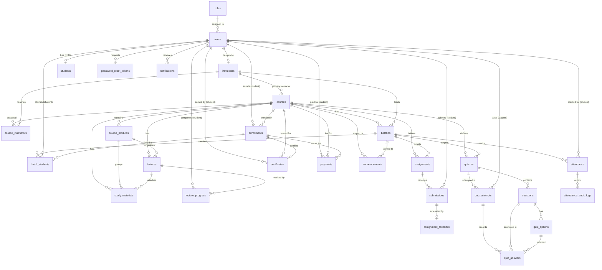

# Entity Relationship Diagram (ERD)

- **Title**: Database ERD — Learning Management System (LMS)
- **Version**: 1.0
- **Author**: Antigravity Engineering
- **Last Updated**: 2026-11-25

---

## Mermaid ERD

---

## Core Relationship Summary
- **Users & Profiles**: `roles` (1) -> `users` (N). `users` (1) -> `students` (0..1) and `users` (1) -> `instructors` (0..1). Domain tables reference `users.id` for `student_id` so JWT `current_user.id` matches ownership directly.
- **Courses & Batches**: `courses` (1) -> `course_modules` (N) -> `lectures` (N). `courses` (M) <-> `instructors` (N) via `course_instructors`. `courses` (1) -> `batches` (N).
- **Enrollments & Batch Roster**: `users` (M) <-> `courses` (N) via `enrollments` (unique per `(student_id, course_id)`). `batches` (M) <-> `users` (N) via `batch_students` (unique per `(batch_id, student_id)`), tied to `enrollments`.
- **Assessments**: `assignments` (1) -> `submissions` (N, versioned per student) -> `assignment_feedback` (0..1). `quizzes` (1) -> `questions` (N) -> `quiz_options` (N); `quiz_attempts` (1) -> `quiz_answers` (N).
- **Operations & Finance**: `attendance` (unique per `(batch_id, student_id, session_date)`) -> `attendance_audit_logs` (N). `enrollments` (1) -> `payments` (N) and `enrollments` (1) -> `certificates` (0..1).
